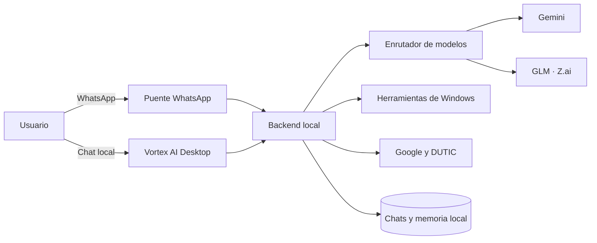
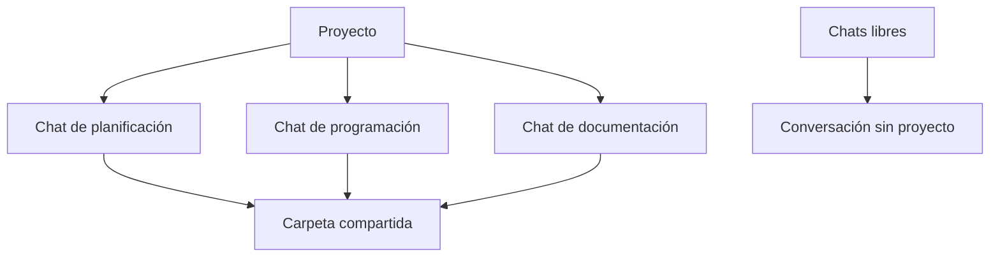
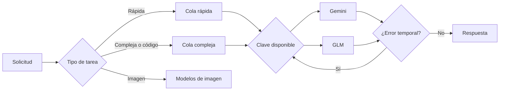
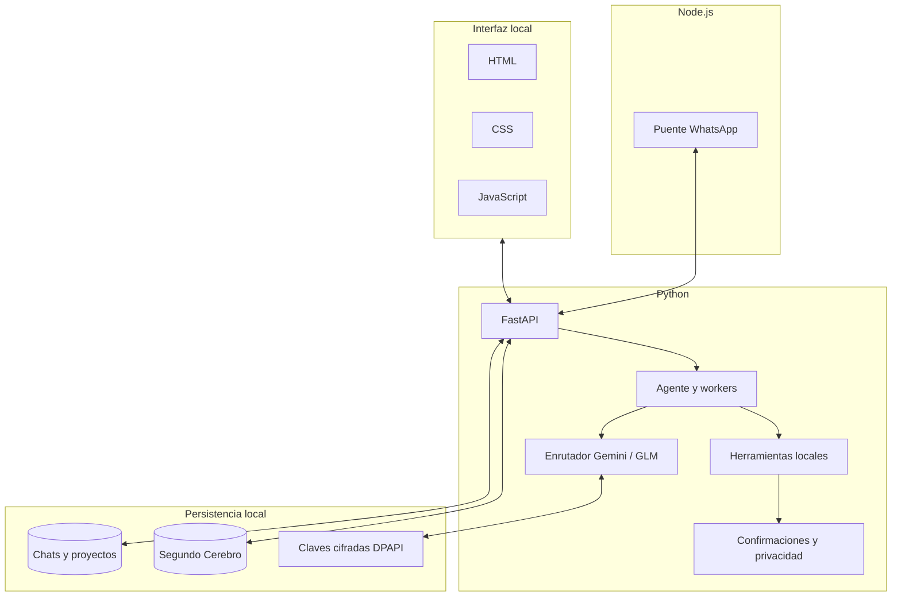
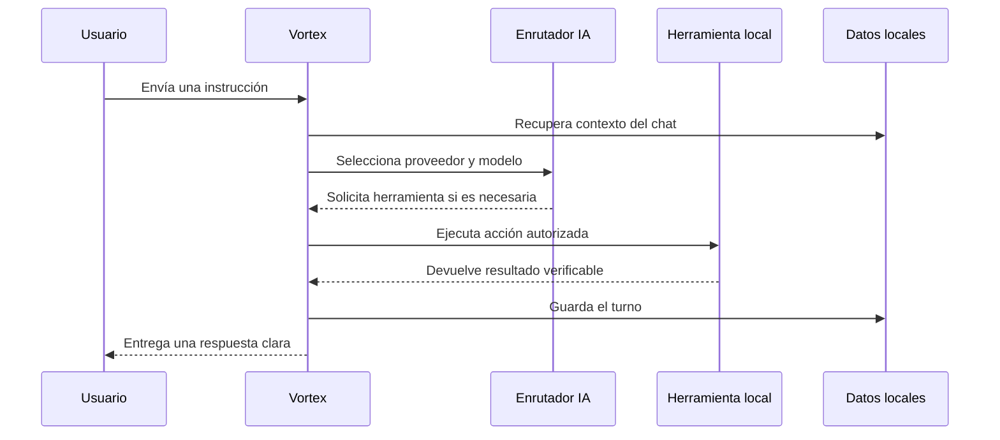
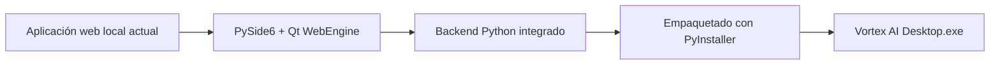

<div align="center">


# Vortex AI Desktop

### Asistente local inteligente para Windows, WhatsApp y productividad académica

[](#requisitos)
[](#tecnologías)
[](#arquitectura)
[](#whatsapp)
[](#estado-del-proyecto)

**Vortex AI Desktop** reúne chats con contexto, proyectos, modelos de IA, WhatsApp, Google Classroom, Drive, Calendar, DUTIC, memoria, automatizaciones y control local del computador en una sola aplicación.

[Características](#características) · [Arquitectura](#arquitectura) · [Instalación](#instalación) · [Integraciones](#integraciones) · [Seguridad](#seguridad-y-privacidad) · [Pruebas](#pruebas)

</div>

---

## Estado del proyecto

> [!IMPORTANT]
> Esta rama contiene la **aplicación web local actual**. Se ejecuta en Windows mediante un lanzador y abre su interfaz como una aplicación independiente. La migración futura a un `.exe` con **Python + PySide6 + Qt WebEngine** está planificada, pero todavía no forma parte de esta versión.

> [!WARNING]
> Vortex puede controlar aplicaciones, ejecutar herramientas locales, leer archivos, tomar capturas y enviar mensajes. Debe utilizarse en un equipo propio, con supervisión y con las confirmaciones de seguridad activadas.

La aplicación trabaja principalmente en `127.0.0.1`: el panel, la API y la comunicación con el puente de WhatsApp no se publican como un servicio web externo.

---

## ¿Qué problema resuelve?

Vortex evita tener herramientas aisladas para cada tarea. Un mismo chat puede consultar actividades académicas, trabajar dentro de una carpeta de proyecto, crear archivos, controlar el equipo y continuar la conversación desde WhatsApp.



---

## Características

### Chats y proyectos

- Conversaciones individuales con historial persistente.
- Contexto separado por chat para reducir consumo innecesario de tokens.
- Proyectos que pueden contener múltiples chats y una carpeta de trabajo compartida.
- Creación, selección, renombrado y eliminación mediante menús y modales.
- Reutilización automática de un chat vacío en lugar de crear duplicados.
- Títulos reconocibles para las primeras conversaciones.
- Importación de contexto entre chats y resumen opcional con IA.
- Lista y selección de chats también desde WhatsApp.
- Continuidad entre conversaciones del teléfono y el panel local.



### Modelos de inteligencia artificial

- Múltiples claves de **Google Gemini** y **GLM · Z.ai**.
- Claves cifradas con DPAPI para el usuario actual de Windows.
- Tabla para agregar, comprobar, editar, revelar, copiar y eliminar claves.
- Descubrimiento del catálogo disponible para cada clave.
- Separación automática entre modelos conversacionales y modelos de imagen.
- Colas para tareas rápidas y complejas.
- Rotación entre claves y proveedores ante saturación temporal.
- Cooldown para cuotas agotadas y errores transitorios.
- Cambio de proveedor sin perder el contexto administrado por Vortex.
- Registro local del consumo reportado por los proveedores.
- Errores breves para el usuario, sin respuestas técnicas interminables.



### WhatsApp

- Vinculación por QR como dispositivo asociado.
- Pantalla de sesión con cuenta, número y estado.
- Desconexión local y generación de un QR nuevo.
- Número autorizado y prefijo opcional configurables desde la aplicación.
- Recepción de texto, imágenes y notas de voz.
- Envío de respuestas, capturas y documentos.
- Contactos guardados para envíos solicitados por el usuario.
- Selección y creación de chats desde WhatsApp.
- Prefijo visual `>_` para identificar al asistente.
- Conversión de Markdown a formato presentable de WhatsApp: títulos limpios, negrita correcta, viñetas, enlaces legibles y código preservado.

| Comando | Función |
|---|---|
| `/chats` | Muestra las conversaciones disponibles |
| `/chat 1` | Selecciona una conversación |
| `/nuevo Nombre` | Crea o reutiliza un chat en el proyecto seleccionado |
| `/salir` | Regresa al contexto general |
| `/reset` | Reinicia el contexto reciente de WhatsApp |

### Integraciones académicas

#### Google Classroom, Drive y Calendar

- Autorización OAuth de escritorio desde la interfaz.
- Cuenta autorizada y archivo OAuth visibles.
- Acciones para volver a autorizar, desconectar o eliminar la conexión local.
- Consulta de cursos, tareas, anuncios y agenda.
- Descarga de adjuntos de Classroom mediante Drive API.
- Creación de eventos en Google Calendar.
- Botón de ayuda con los pasos completos de configuración.

#### DUTIC

- Conexión mediante URL privada iCal, sin guardar la contraseña de DUTIC.
- Lectura de eventos, entregas y actividades próximas.
- Estado visible de la integración.
- Sustitución o eliminación de la URL guardada.
- Ayuda integrada para obtener correctamente la URL dinámica.

### Archivos y productividad

- Proyectos y archivos creados dentro de su carpeta correcta.
- Generación local de HTML, CSS, JavaScript y otros archivos de código.
- Documentos DOCX, hojas XLSX, presentaciones PPTX y PDF mediante bibliotecas locales.
- Lectura y análisis de PDF.
- Búsqueda profunda en documentos, código y carpetas comunes.
- Inspección y organización de carpetas.
- Seguimiento y verificación de descargas.
- Vista de artefactos desde el menú **Archivos**.
- Copias de respaldo antes de reemplazar archivos importantes cuando corresponde.

### Control del computador

- Métricas de CPU, RAM, batería, disco y procesos.
- Detección y selección de monitores.
- Capturas de una pantalla o panorámica multimonitor.
- Apertura y control de aplicaciones y ventanas.
- Automatización de Brave con la sesión real del usuario.
- Automatización visual de mouse, teclado y atajos.
- Comandos multimedia, portapapeles y lectura por voz.
- Terminal y administración Git con controles de seguridad.
- Modos de estudio, universidad, concentración o cine.
- Captura opcional de webcam cuando el usuario la solicita.

### Memoria y automatizaciones

- **Segundo Cerebro:** notas persistentes y búsquedas en SQLite.
- Memoria reciente independiente por conversación.
- Temporizadores y recordatorios.
- Alertas de batería baja.
- Vigilancia de procesos.
- Revisión programada de DUTIC.
- Notificaciones proactivas por WhatsApp.

### Experiencia de escritorio

- Diseño profesional claro y oscuro.
- Menú lateral contraíble con iconos.
- Barra superior fija con estado del sistema.
- Historial desplazable y caja de escritura fija.
- Modales centrados para creación, ayuda, confirmación y eliminación.
- Interfaz adaptable a diferentes tamaños de ventana.
- Conexiones administrables sin editar código.

---

## Arquitectura



### Estructura principal

```text
Vortex-AI-Desktop/
├── agent_core/
│   ├── agent.py              # Orquestación, workers y herramientas de IA
│   ├── server.py             # FastAPI, panel y endpoints locales
│   ├── chats.py              # Proyectos, chats e historial
│   ├── provider_keys.py      # Claves cifradas y catálogos
│   ├── glm_provider.py       # Adaptador GLM
│   ├── tools.py              # Herramientas del computador
│   ├── tools_drive.py        # Classroom, Drive y documentos
│   ├── memory_vault.py       # Segundo Cerebro
│   ├── watchdog.py           # Alertas y automatizaciones
│   ├── security.py           # Confirmaciones y privacidad
│   ├── admin.py              # Configuración e integraciones
│   ├── dashboard.html        # Estructura visual
│   ├── admin.css             # Temas y diseño adaptable
│   ├── admin.js              # Chats, proyectos e integraciones
│   ├── keys.js               # Administración de claves
│   └── whatsapp.js           # Administración de WhatsApp
├── whatsapp_bridge/
│   ├── index.js              # Mensajería y sesión
│   └── index.test.js         # Pruebas de formato
├── assets/vortex-ai-logo.png
├── tests/                    # Pruebas de regresión
├── gui_launcher.py           # Lanzador silencioso
├── iniciar_vortex.bat        # Inicio rápido
├── setup_google_auth.py      # OAuth alternativo por consola
├── requirements.txt
└── .env.example
```

---

## Tecnologías

| Área | Tecnología |
|---|---|
| Agente y herramientas | Python 3.11+ |
| API local | FastAPI + Uvicorn |
| Interfaz actual | HTML, CSS y JavaScript |
| Modelos | Google Gemini y GLM · Z.ai |
| WhatsApp | Node.js + Baileys |
| Persistencia | SQLite y archivos locales protegidos |
| Google | OAuth 2.0 + Classroom, Drive y Calendar API |
| Automatización | PyAutoGUI, Playwright, Win32 y Windows |
| Documentos | python-docx, openpyxl, python-pptx, pypdf y fpdf2 |
| Futuro `.exe` | PySide6 + Qt 6 + Qt WebEngine + PyInstaller |

---

## Requisitos

- Windows 10 u 11.
- Python 3.11 o superior.
- Node.js 18 o superior con npm.
- Una clave válida de Gemini o GLM.
- Brave, Chrome o Edge para las funciones web.
- WhatsApp en el teléfono para vincular el dispositivo.
- Google Cloud solo si utilizarás Classroom, Drive o Calendar.

---

## Instalación

### 1. Clonar esta rama

```powershell
git clone -b feat/vortex-ai-desktop https://github.com/Pol-Codificador/Agente-UNSA.git Vortex-AI-Desktop
cd Vortex-AI-Desktop
```

### 2. Preparar Python

```powershell
python -m venv .venv
.\.venv\Scripts\python.exe -m pip install --upgrade pip
.\.venv\Scripts\python.exe -m pip install -r requirements.txt
```

Para navegación automatizada:

```powershell
.\.venv\Scripts\playwright.exe install chromium
```

### 3. Preparar WhatsApp

```powershell
cd whatsapp_bridge
npm install
cd ..
```

### 4. Iniciar Vortex

Haz doble clic en `iniciar_vortex.bat` o ejecuta:

```powershell
.\.venv\Scripts\pythonw.exe gui_launcher.py
```

El lanzador inicia el backend, el puente de WhatsApp y la ventana local.

### Inicio manual para desarrollo

```powershell
# Terminal 1
.\.venv\Scripts\python.exe -m agent_core.server

# Terminal 2
npm --prefix whatsapp_bridge start
```

Panel local: `http://127.0.0.1:8000/dashboard`

---

## Integraciones

### Claves de IA

1. Abre **Configuración**.
2. Pulsa **Agregar API key**.
3. Selecciona Gemini o GLM.
4. Guarda y pulsa **Comprobar**.
5. Revisa los modelos detectados.

### WhatsApp

1. Abre **WhatsApp → Sesión**.
2. Pulsa **Generar QR nuevo**.
3. En el teléfono abre **Dispositivos vinculados → Vincular un dispositivo**.
4. Escanea el QR.
5. Configura el número autorizado en **Acceso**.

### Google

1. Crea un proyecto en Google Cloud.
2. Habilita Drive API, Calendar API y Classroom API.
3. Configura Google Auth Platform y los usuarios de prueba.
4. Crea un cliente OAuth de tipo **Aplicación de escritorio**.
5. Descarga el JSON.
6. En Vortex abre **Integraciones**, selecciona el archivo y autoriza la cuenta.

Vortex permite desconectar el token conservando el JSON o eliminar por completo ambos archivos locales.

### DUTIC

1. Abre DUTIC → Calendario → Importar o exportar calendarios → Exportar calendario.
2. Selecciona **Todos los eventos**.
3. Selecciona **60 días recientes y próximos**.
4. Pulsa **Obtener URL del calendario**.
5. Copia la URL en **Integraciones → Calendario DUTIC**.

No uses **Exportar** si quieres sincronización: descarga una copia estática.

---

## Flujo de una solicitud



---

## Seguridad y privacidad

### Datos que permanecen locales

- Chats, proyectos y Segundo Cerebro.
- Claves de proveedores cifradas.
- Token y credenciales OAuth de Google.
- URL privada iCal de DUTIC.
- Sesión de WhatsApp y caché de contactos.
- Capturas, registros y archivos temporales.

### Excluidos de Git

```text
.env
.provider_keys.json*
credentials.json
token.json
google_connection.json
*.db / *.sqlite*
whatsapp_bridge/auth_info_baileys/
whatsapp_bridge/processed_messages.json
whatsapp_bridge/contacts_cache.json
temp/*
generated_projects/
```

> [!CAUTION]
> Nunca publiques claves API, JSON OAuth, `token.json`, la URL iCal ni la sesión de WhatsApp. Revisa siempre `git status` antes de confirmar cambios.

### Controles incorporados

- Administración limitada al equipo local.
- Validación del origen de solicitudes de configuración.
- Confirmación antes de operaciones críticas.
- Número autorizado para WhatsApp.
- Protección de archivos sensibles.
- Separación entre contenido externo e instrucciones.
- Capturas internas sin envío automático por WhatsApp.
- Identidad consistente de Vortex sin exponer detalles internos.

---

## Ejemplos de uso

```text
¿Qué tareas tengo pendientes en Classroom y DUTIC esta semana?
```

```text
Crea un proyecto llamado Portal académico y prepara un index.html.
```

```text
Busca los PDF que mencionen normalización y resume el más reciente.
```

```text
Agenda mañana de 18:00 a 20:00 un bloque de estudio de Redes.
```

```text
Avísame por WhatsApp cuando termine este proceso.
```

---

## Pruebas

```powershell
# Python
.\.venv\Scripts\python.exe -m unittest discover -s tests -v

# Puente de WhatsApp
npm --prefix whatsapp_bridge test

# Sintaxis
.\.venv\Scripts\python.exe -m compileall -q agent_core
node --check agent_core/admin.js
node --check whatsapp_bridge/index.js
```

La suite cubre proyectos y chats, borradores vacíos, proveedores, fallback de modelos, archivos locales, identidad, Google, DUTIC, WhatsApp y preferencias de generación web.

---

## Servidor MCP opcional

```json
{
  "mcpServers": {
    "vortex-ai-desktop": {
      "command": "C:\\ruta\\Vortex-AI-Desktop\\.venv\\Scripts\\python.exe",
      "args": ["-m", "agent_core.mcp_server"],
      "cwd": "C:\\ruta\\Vortex-AI-Desktop"
    }
  }
}
```

---

## Ruta hacia la aplicación `.exe`



Objetivos de la siguiente etapa:

- ejecutar un único `.exe`;
- configurar claves, WhatsApp e integraciones desde la interfaz;
- distribuir la aplicación sin entregar el código fuente;
- separar datos y secretos por usuario de Windows;
- conservar chats, proyectos, automatizaciones y control del PC.

---

## Contribución

1. Crea una rama para tu cambio.
2. No incluyas datos locales ni secretos.
3. Agrega o actualiza pruebas.
4. Ejecuta las comprobaciones anteriores.
5. Usa commits breves y descriptivos.

---

<div align="center">

**Vortex AI Desktop** · Tu asistente, tus proyectos y tu computador en un solo lugar.

</div>
